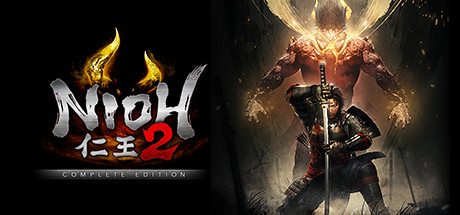

**Nioh 2: The Complete Edition by Team Ninja (PC 2021) includes all three DLC expansions.**

---

## 📖 About

Nioh 2: The Complete Edition by Team Ninja (PC 2021) includes all three DLC expansions. Set in the Sengoku period, you play a half-Yokai warrior mastering the ki pulse system across three weapon stances. The endgame Depths of the Underworld is among the hardest content in the soulslike genre.

## ⚠️ Problems Without Trainer

| Problem | Status |
|---------|--------|
| Depths of the Underworld floors exceed gear power walls requiring farm loops | ✅ Solved |
| Yokai Shift timing windows missed against fast enemies drain entire spirit gauge | ✅ Solved |
| Soul Core farming in NG+ requires specific enemy types with low fusion rates | ✅ Solved |
| Burst Counter windows vary per enemy making mastery of all bosses mandatory | ✅ Solved |
| Cursed equipment debuffs stack in late Depths creating unmanageable stat deficits | ✅ Solved |

## ✅ Solution

The **Nioh 2 – The Complete Edition Trainer** solves all these issues, giving you complete control so you can focus on enjoying the game.

## 🎯 Features

- Unlimited Resources / Currency
- God Mode / Invincibility
- Instant Skill & Ability Cooldown
- One-Hit Kill
- Freeze Timers
- Unlock All Items & Achievements
- Custom Speed Multiplier
- Infinite Stamina / Energy

## 🚀 Quick Start

1. **Disable Windows Defender** temporarily (trainer may trigger false positive)
2. Get the trainer from the button above
3. Launch Nioh 2 – The Complete Edition
4. Run the trainer as Administrator
5. Use the hotkeys to activate cheats in-game

## 💎 Free vs Pro

| Feature | Free | Pro |
|---------|------|-----|
| God Mode | ✅ | ✅ |
| Unlimited Resources | ✅ | ✅ |
| Advanced Cheats | ❌ | ✅ |
| Auto-Updates | ❌ | ✅ |
| Priority Support | ❌ | ✅ |

## 💻 Requirements

- Windows 10 / 11 (64-bit)
- Nioh 2 – The Complete Edition (any version)
- .NET Framework 4.8+
- DirectX 11+

## 🍎 macOS

## ⚖️ Legal

Educational and single-player use only.

---

